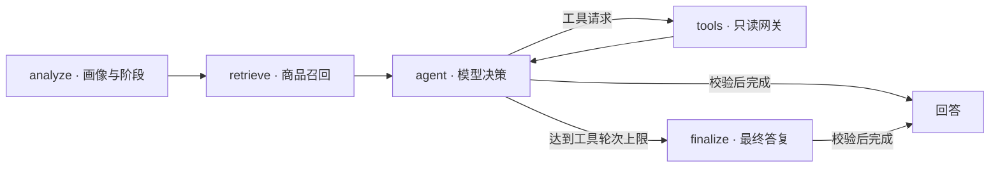

# ShopSift

**基于 LangGraph 的购物 Agent，结合会话画像、混合检索与受控工具调用。**

支持笔记本、手机、平板、无线耳机及显示器、键盘、鼠标的试点选购：用户描述预算和用途，Agent 在多轮对话中维护需求、检索商品、查询有来源的体验资料并对比候选。React 界面展示回答与调试信息，FastAPI 提供聊天和会话接口。

例如：`预算 8000 元，主要办公，不打游戏，推荐几款笔记本。` 接着可以补充偏好、追问某款商品或比较候选，在同一会话中逐步完成选购。

> 仓库默认提供[500个真实型号、549条配置](datasets/real_catalog/README.md)：笔记本、手机各75型号，平板、无线耳机、显示器、键盘、鼠标各70型号。采用一个选定公开来源，价格为人民币快照，缺失字段显示“未知”；体验及真实对话能力仍为试点。首次初始化从JSONL导入双库并构建索引，无需访问商品网站；聊天需配置模型API。

[Docker 启动](#docker-启动) · [本地启动](#本地启动) · [Agent 设计](#agent-设计) · [测试与评测](#测试与评测)

## Docker 启动

安装并启动 Docker Engine（Windows / macOS 可使用 Docker Desktop），确认 `docker info` 和 `docker compose version` 能正常执行后，可使用容器运行，无需在本机安装 Python / Node.js。

1. 克隆仓库，进入 `shopsift` 目录。
2. 将 `.env.example` 复制为 `.env`，填写 `OPENAI_API_KEY`、`OPENAI_BASE_URL`、`LLM_MODEL`；已有配置时保留原文件。
3. 在仓库根目录执行：

```bash
docker compose up --build
```

Compose 先检查配置，在默认双库均不存在时导入镜像内置 JSONL，加载嵌入模型并首次构建索引；初始化成功后启动后端，后端可访问后再启动前端。已有双库保持原样，匹配的完整索引会复用；部分、空或损坏的数据库会明确报错。打开 [http://localhost:5173](http://localhost:5173)，按下方[对话示例](#4-体验一次多轮对话)体验。

首次运行需要下载镜像、依赖和嵌入模型；数据保存在 `./data`，模型缓存保存在命名卷中。初始化失败时查看 `docker compose logs init`；数据更新后的重建、离线使用与停止方式见[Docker 说明](DEVELOPMENT.md#docker)。模型 API 是否可用在实际对话时验证。

此配置用于本地体验，端口仅绑定本机。Docker容器构建及完整启动尚未完成验收。

## 本地启动

本地启动已在 Windows、Python 3.12、Node.js 24 下验证；Linux / macOS 命令未在本机实测。需要 Git 和支持工具调用的 OpenAI-compatible 模型 API；商品数据已随仓库提供。首次安装依赖、构建索引需要联网下载包和嵌入模型；Redis 和 LangSmith 均为可选项，默认关闭。

### 1. 获取代码并安装依赖

先用 `python --version` 和 `node --version` 核对版本。下面的 `python` 应指向 Python 3.12；若系统默认版本不同，请改用已安装的 Python 3.12 可执行文件创建虚拟环境（Linux / macOS 通常为 `python3.12`，安装了 Python Launcher 的 Windows 可用 `py -3.12`）。已有 `.venv` 时跳过创建，不要用系统 Python 重建现有环境。后续按对应系统的命令安装依赖。

```bash
git clone https://github.com/SugarAbsinthe/shopsift.git
cd shopsift
python -m venv .venv
```

选择对应系统的命令，在仓库根目录执行。已有本地仓库可跳过克隆；已有 `.env` 时保留原配置，跳过复制。

<details>
<summary>Linux / macOS</summary>

```bash
source .venv/bin/activate
python -m pip install -e ".[dev]"
cp .env.example .env
npm --prefix frontend ci
```

</details>

<details>
<summary>Windows PowerShell</summary>

```powershell
.\.venv\Scripts\python.exe -m pip install -e ".[dev]"
if (!(Test-Path .env)) { Copy-Item .env.example .env }
npm.cmd --prefix frontend ci
```

Windows 命令直接使用项目虚拟环境，无需激活，也无需修改执行策略；即使提示符显示 `(base)`，也不会把依赖安装到 Anaconda。以下通用示例中的 `python` 在 PowerShell 中同样替换为 `.\.venv\Scripts\python.exe`，`npm` 替换为 `npm.cmd`。

</details>

### 2. 配置模型与数据

编辑根目录 `.env` 中的三项配置，使用你的服务商提供的值；[`.env.example`](.env.example) 给出了配置示例：

| 配置 | 内容 |
|---|---|
| `OPENAI_API_KEY` | 模型 API 密钥 |
| `OPENAI_BASE_URL` | OpenAI-compatible API 地址 |
| `LLM_MODEL` | 支持工具调用的模型名 |

在仓库根目录初始化内置数据与索引：

```bash
python -m backend.bootstrap
```

Windows PowerShell 对应命令：

```powershell
.\.venv\Scripts\python.exe -m backend.bootstrap
```

终端输出 `Activated retrieval index ...` 或 `Reusing retrieval index ...` 表示准备完成。默认使用 `BAAI/bge-small-zh-v1.5`，首次运行会下载权重；初始化不调用聊天模型 API。数据或模型变化时用 `python -m backend.bootstrap --rebuild-index` 显式重建，并重启后端。仅校验或导入双库可使用不加载嵌入模型的 `python -m src.data.prepare_catalog --validate-only` / `python -m src.data.prepare_catalog`；自定义路径见[开发说明](DEVELOPMENT.md#数据与索引)。

### 3. 启动后端与前端

打开两个终端，起始目录都为仓库根目录：

**Windows PowerShell（无需激活环境）：**

```powershell
# 终端 1：明确使用项目 .venv，不能直接使用 Anaconda base 的 python
.\.venv\Scripts\python.exe -m uvicorn backend.main:app --host 127.0.0.1 --port 8000
```

```powershell
# 终端 2：从仓库根目录启动前端
npm.cmd --prefix frontend run dev
```

**Linux / macOS：**

```bash
# 终端 1：新终端需要重新激活虚拟环境
source .venv/bin/activate
python -m uvicorn backend.main:app --port 8000
```

```bash
# 终端 2：启动前端
cd frontend
npm run dev
```

后端 API 文档：[http://localhost:8000/docs](http://localhost:8000/docs)。前端默认：[http://localhost:5173](http://localhost:5173)，以 Vite 终端输出的 `Local` 地址为准；5173 被占用时可能自动换用其他端口。本地前端代理连接后端的 8000 端口，后端若因端口占用启动失败，需先解决冲突再重试；API 文档能打开表示服务已启动，模型与检索链路在首次对话时初始化。

若报 `D:\Anaconda3\python.exe: No module named uvicorn`，说明使用了 Anaconda 环境；请运行上面的 `.venv` 完整命令。若 `.venv` 也缺少依赖，先执行 Windows 安装依赖步骤。两条服务命令保持各自终端运行，按 `Ctrl+C` 停止；本地模式与 Docker 模式默认共用 8000 / 5173 端口，不要同时启动两套。

### 4. 体验一次多轮对话

在界面点击“新对话”，可以依次尝试：

1. `预算 8000 元，主要办公，不打游戏，推荐几款笔记本。`
2. `经常出差，希望轻一点。`
3. 根据实际返回的候选，追问：`比较这两款的配置和价格。`（指定候选名称）

点击右上角“调试”可查看当前阶段、会话画像、检索上下文和工具轮次。具体推荐由你的商品目录与模型决定；没有满足条件的商品时，需要调整条件或补充目录。首次对话可能因加载嵌入模型而较慢。

尚未准备商品数据或模型 API，也可以先运行下方的确定性评测了解执行行为。启动问题见[排错说明](DEVELOPMENT.md#启动排错)。

## Agent 设计



## 测试与评测

完成依赖安装后，以下 Python 命令在仓库根目录、已激活的虚拟环境中运行：

```bash
python -m evals.runner --mode deterministic
python -m pytest tests -q
```

```bash
# 新终端：从仓库根目录进入前端目录
cd frontend
npm test
npm run build
```

确定性评测使用真实图编排和受控依赖，不需要模型 API、商品库或嵌入权重。25 个案例验证路由、工具边界、画像与终止行为，报告写入 `evals/results/`；不能据此推断真实模型的回答质量。pytest 显式限定 `tests/`，避免误收集本地 `data/` 中的历史测试或验收副本。

准备内置数据与索引后，`python -m evals.retrieval_runner` 默认运行 76 条真实目录 RAG 案例，绑定目录版本与哈希，报告实际 Recall@5、命中率和来源覆盖率。`python -m evals.catalog_smoke` 验证七类商品的实际检索、工具及图流程，使用受控本地模型。原有 30 条契约集保持显式运行；远程 Live 评测需配置目标模型，命令与门禁见[开发说明](DEVELOPMENT.md)，数据口径与能力限制见[目录说明](datasets/real_catalog/README.md)。

## 源码导航

| 目录 | 职责 |
|---|---|
| [`src/agent/`](src/agent/) | 图编排、阶段 Prompt、工具网关与证据校验接入 |
| [`src/retrieval/`](src/retrieval/) | 混合召回、融合、约束、证据与活动索引清单 |
| [`src/profile/`](src/profile/) | 画像候选生命周期与会话记忆 |
| [`src/data/`](src/data/) / [`datasets/real_catalog/`](datasets/real_catalog/README.md) | 来源校验、双库导入与当前商品目录；仓库仅保留最新数据 |
| [`backend/`](backend/) / [`frontend/`](frontend/) | FastAPI REST / SSE 与 React + TypeScript 界面 |
| [`evals/`](evals/) / [`tests/`](tests/) | 评测案例、质量门禁与回归测试 |

## License

MIT
