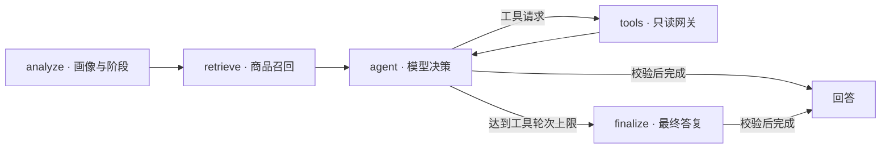

# ShopSift

**基于 LangGraph 的购物 Agent，结合会话画像、混合检索与受控工具调用。**

以笔记本选购为主要场景：用户描述预算和用途，Agent 在多轮对话中维护需求、检索商品、查询评价并对比候选。React 界面展示回答与调试信息，FastAPI 提供聊天和会话接口。

例如：`预算 8000 元，主要办公，不打游戏，推荐几款笔记本。` 接着可以补充偏好、追问某款商品或比较候选，在同一会话中逐步完成选购。

> 数据说明：真实商品数据信息需自行维护，也可采用模拟数据观察 Agent 行为；后续将补充模拟数据以方便使用。当前仓库不附带商品库和索引，完整对话需要先准备数据，并配置模型 API。

[Docker 启动](#docker-启动) · [本地启动](#本地启动) · [Agent 设计](#agent-设计) · [测试与评测](#测试与评测)

## Docker 启动

安装 Docker 与 Compose V2 后，可使用容器运行，无需在本机安装 Python / Node.js。

1. 克隆仓库，进入 `shopsift` 目录。
2. 将 `.env.example` 复制为 `.env`，填写 `OPENAI_API_KEY`、`OPENAI_BASE_URL`、`LLM_MODEL`；已有配置时保留原文件。
3. 按[数据契约](DEVELOPMENT.md#数据与索引)准备 `data/products.db` 和 `data/product_reviews.db`。
4. 在仓库根目录执行：

```bash
docker compose up --build
```

Compose 先检查配置与数据、加载嵌入模型，并在尚无索引时自动构建；初始化成功后启动后端，后端可访问后再启动前端。已有完整索引会复用。打开 [http://localhost:5173](http://localhost:5173)，按下方[对话示例](#4-体验一次多轮对话)体验。

首次运行需要下载镜像、依赖和嵌入模型；数据保存在 `./data`，模型缓存保存在命名卷中。初始化失败时查看 `docker compose logs init`；数据更新后的重建、离线使用与停止方式见[Docker 说明](DEVELOPMENT.md#docker)。模型 API 是否可用在实际对话时验证。

此配置用于本地体验，端口仅绑定本机。当前开发环境没有 Docker，初始化逻辑与前端代理已进行本地回归检查，容器构建及完整启动仍需在 Docker 环境验收。

## 本地启动

本地已验证 Python 3.12、Node.js 24。需要 Git、支持工具调用的 OpenAI-compatible 模型 API，以及商品与评价数据。首次安装依赖、构建索引需要联网下载包和嵌入模型；Redis 和 LangSmith 均为可选项，默认关闭。

### 1. 获取代码并安装依赖

```bash
git clone https://github.com/SugarAbsinthe/shopsift.git
cd shopsift
python -m venv .venv
```

选择对应系统的命令，在仓库根目录执行。已有本地仓库可跳过克隆；已有 `.env` 时保留原配置，跳过复制。

<details>
<summary>Linux / macOS</summary>

```bash
source .venv/bin/activate
python -m pip install -e ".[dev]"
cp .env.example .env
npm --prefix frontend ci
```

</details>

<details>
<summary>Windows PowerShell</summary>

```powershell
.\.venv\Scripts\Activate.ps1
python -m pip install -e ".[dev]"
Copy-Item .env.example .env
npm.cmd --prefix frontend ci
```

如果执行策略阻止激活，后续所有 `python` 命令均可改用 `.\.venv\Scripts\python.exe`，无需修改系统执行策略。PowerShell 中可使用 `npm.cmd` 代替 `npm`。

</details>

### 2. 配置模型与数据

编辑根目录 `.env` 中的三项配置，使用你的服务商提供的值；[`.env.example`](.env.example) 给出了配置示例：

| 配置 | 内容 |
|---|---|
| `OPENAI_API_KEY` | 模型 API 密钥 |
| `OPENAI_BASE_URL` | OpenAI-compatible API 地址 |
| `LLM_MODEL` | 支持工具调用的模型名 |

按[数据契约](DEVELOPMENT.md#数据与索引)准备 `data/products.db` 和 `data/product_reviews.db`，然后在仓库根目录构建索引：

```bash
python -m src.embeddings.product_embedder
```

终端输出 `Activated retrieval index ...` 表示索引构建完成。默认使用 `BAAI/bge-small-zh-v1.5`，首次运行会下载权重；以后仅在商品数据更新时重新构建，并重启后端。自定义数据路径或模型的方式见开发说明。

### 3. 启动后端与前端

打开两个终端，起始目录都为仓库根目录：

```bash
# 终端 1：激活 Python 虚拟环境后启动后端
python -m uvicorn backend.main:app --port 8000
```

```bash
# 终端 2：启动前端
cd frontend
npm run dev
```

后端 API 文档：[http://localhost:8000/docs](http://localhost:8000/docs)。前端：[http://localhost:5173](http://localhost:5173)。本地前端代理连接后端的 8000 端口；API 文档能打开表示服务已启动，模型与检索链路在首次对话时初始化。

### 4. 体验一次多轮对话

在界面点击“新对话”，可以依次尝试：

1. `预算 8000 元，主要办公，不打游戏，推荐几款笔记本。`
2. `经常出差，希望轻一点。`
3. 根据实际返回的候选，追问：`比较这两款的配置和价格。`（指定候选名称）

点击右上角“调试”可查看当前阶段、会话画像、检索上下文和工具轮次。具体推荐由你的商品目录与模型决定；没有满足条件的商品时，需要调整条件或补充目录。首次对话可能因加载嵌入模型而较慢。

尚未准备商品数据或模型 API，也可以先运行下方的确定性评测了解执行行为。启动问题见[排错说明](DEVELOPMENT.md#启动排错)。

## Agent 设计



## 测试与评测

完成依赖安装后，以下 Python 命令在仓库根目录、已激活的虚拟环境中运行：

```bash
python -m evals.runner --mode deterministic
python -m pytest -q
```

```bash
# 新终端：从仓库根目录进入前端目录
cd frontend
npm test
npm run build
```

确定性评测使用真实图编排和受控依赖，不需要模型 API、商品库或嵌入权重。25 个案例验证路由、工具边界、画像与终止行为，报告写入 `evals/results/`；不能据此推断真实模型的回答质量。

配置目标模型和商品数据后，可运行 Live 评测与 30 个 RAG 案例。RAG 案例绑定特定商品 ID，需要匹配的数据；命令、指标和门禁说明见[开发与评测说明](DEVELOPMENT.md)。

## 源码导航

| 目录 | 职责 |
|---|---|
| [`src/agent/`](src/agent/) | 图编排、阶段 Prompt、工具网关与证据校验接入 |
| [`src/retrieval/`](src/retrieval/) | 混合召回、融合、约束、证据与活动索引清单 |
| [`src/profile/`](src/profile/) | 画像候选生命周期与会话记忆 |
| [`backend/`](backend/) / [`frontend/`](frontend/) | FastAPI REST / SSE 与 React + TypeScript 界面 |
| [`evals/`](evals/) / [`tests/`](tests/) | 评测案例、质量门禁与回归测试 |

## License

MIT
