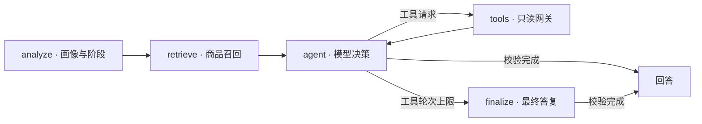

# ShopSift

基于 LangGraph 的购物 Agent，结合多轮需求、会话画像、混合检索与受控工具调用，提供 React 界面和 FastAPI 接口。

内置[真实商品目录](datasets/real_catalog/README.md)：笔记本、手机、平板、无线耳机、显示器、键盘、鼠标，共 **500 个型号、549 条配置**。价格为人民币快照，缺失信息保持未知；体验与全品类真实对话能力仍为试点。初始化使用仓库 JSONL，无需访问商品网站；聊天需配置支持工具调用的模型 API。

[Docker 启动](#docker-启动) · [本地启动](#本地启动) · [开发说明](DEVELOPMENT.md)

## 获取代码

```bash
git clone https://github.com/SugarAbsinthe/shopsift.git
cd shopsift
```

已有仓库可跳过克隆；以下命令均从仓库根目录执行。

## Docker 启动

需要 Docker Engine + Compose；WSL 使用 Docker Desktop 时，启用当前发行版的 WSL Integration。已有本地前后端须先停止，避免占用 8000 / 5173。

1. 将 `.env.example` 复制为 `.env`（已有文件保留）。
2. 填写 `OPENAI_API_KEY`、`OPENAI_BASE_URL`、`LLM_MODEL`。
3. 执行：

```bash
docker compose config --quiet
docker compose up --build
```

打开 [http://localhost:5173](http://localhost:5173)，API 文档位于 [http://localhost:8000/docs](http://localhost:8000/docs)。

默认双库均不存在时自动导入数据，并准备嵌入模型和索引；已有数据库保留，匹配的完整索引复用。默认 CPU 运行，无需 CUDA；数据位于 `./data`，模型缓存位于命名卷。首次需要联网，容器路径不能沿用本机 Windows / WSL 路径；离线、代理及重建方法见[开发说明](DEVELOPMENT.md#docker)。

```bash
docker compose ps -a                 # 查看状态
docker compose logs -f init backend  # 查看日志
docker compose down                  # 停止，保留数据和缓存
```

## 本地启动

推荐使用已验证的 **Python 3.12、Node.js 24**。Windows 与 WSL 使用独立项目副本、虚拟环境和 `node_modules`；WSL 副本建议放在 `~/projects/`。缺少 Linux 环境时见 [WSL 环境准备](DEVELOPMENT.md#wsl-环境准备)。

### 1. 安装依赖

已有当前系统可用的虚拟环境或 `.env` 时，跳过对应创建步骤。

<details>
<summary>Linux / WSL（Bash，CPU）</summary>

```bash
python3.12 -m venv .venv
source .venv/bin/activate
python -m pip install torch --index-url https://download.pytorch.org/whl/cpu
python -m pip install -e ".[dev]"
npm --prefix frontend ci
if [ ! -f .env ]; then cp .env.example .env; fi
```

</details>

<details>
<summary>Windows PowerShell</summary>

```powershell
py -3.12 -m venv .venv
.\.venv\Scripts\python.exe -m pip install -e ".[dev]"
npm.cmd --prefix frontend ci
if (!(Test-Path .env)) { Copy-Item .env.example .env }
```

</details>

macOS 尚未实测；依赖安装可参考 Linux 流程，PyTorch 使用默认安装源。

### 2. 配置并初始化

在 `.env` 中填写 `OPENAI_API_KEY`、`OPENAI_BASE_URL`、`LLM_MODEL`，模型须支持 OpenAI-compatible 工具调用。WSL 路径使用 Linux 写法，首次下载权重时关闭离线模式。

```bash
python -m backend.bootstrap
```

Windows 将 `python` 替换为 `.\.venv\Scripts\python.exe`。默认嵌入模型为 `BAAI/bge-small-zh-v1.5`；输出 `Activated retrieval index ...` 或 `Reusing retrieval index ...` 表示准备完成。初始化不调用聊天 API。

### 3. 启动服务

两个终端均从仓库根目录执行。

**Linux / WSL（Bash）：**

```bash
# 终端 1：后端
source .venv/bin/activate
python -m uvicorn backend.main:app --host 127.0.0.1 --port 8000
```

```bash
# 终端 2：前端
npm --prefix frontend run dev
```

**Windows PowerShell：**

```powershell
# 终端 1：后端
.\.venv\Scripts\python.exe -m uvicorn backend.main:app --host 127.0.0.1 --port 8000
```

```powershell
# 终端 2：前端
npm.cmd --prefix frontend run dev
```

访问 [http://localhost:5173](http://localhost:5173)，API 文档为 [http://localhost:8000/docs](http://localhost:8000/docs)。Vite 换端口时以终端输出为准；前端代理默认连接 8000 后端。分别按 `Ctrl+C` 停止服务。

### 4. 体验多轮对话

新建会话后依次尝试：

1. `预算 8000 元，主要办公，不打游戏，推荐几款笔记本。`
2. `经常出差，希望轻一点。`
3. 指定实际候选名称：`比较这两款的配置和价格。`

右上角“调试”可查看阶段、画像、检索上下文和工具轮次。首次对话会加载嵌入模型；可刷新页面检查消息是否保存。

## 测试与评测

```bash
python -m pytest tests -q
python -m evals.runner --mode deterministic
npm --prefix frontend test
npm --prefix frontend run build
```

确定性评测含 25 个案例，不需要模型 API、商品库或权重。真实目录 RAG、七品类冒烟及 Live 评测见[开发说明](DEVELOPMENT.md#测试与评测)。

## Agent 设计



源码：[`src/agent/`](src/agent/) 图与工具，[`src/retrieval/`](src/retrieval/) 检索与证据，[`src/profile/`](src/profile/) 画像，[`src/data/`](src/data/) 目录导入，[`backend/`](backend/) / [`frontend/`](frontend/) 接口与界面。

## License

MIT
